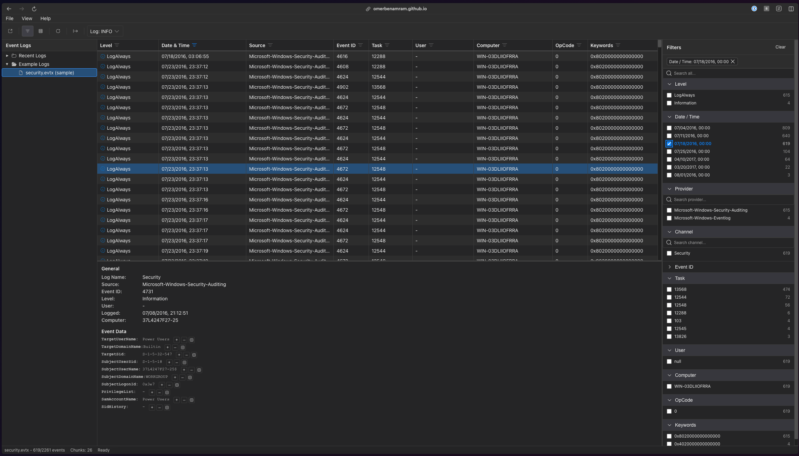

<h1 align="center"> EVTX</h1>
<div align="center">
  <p><strong>A parser for the Windows XML Event Log (EVTX) format, for any platform</strong></p>
  <a href="https://crates.io/crates/evtx"></a>
  <a href="https://crates.io/crates/evtx"></a>
  <a href="https://docs.rs/evtx"></a>
  <a href="https://github.com/rust-secure-code/safety-dance/"></a>
  <a href="https://github.com/omerbenamram/evtx/actions/workflows/test.yml"></a>
</div>

<br />

`evtx` reads `.evtx` event logs without Windows. It comes as a command-line tool, `evtx_dump`, and as a Rust library. Python bindings are in [pyevtx-rs](https://github.com/omerbenamram/pyevtx-rs) (`pip install evtx`).

```console
$ evtx_dump -o jsonl samples/security.evtx | jq -c 'select(.Event.System.EventID == 4720) | .Event.EventData | {SubjectUserName, TargetUserName}'
{"SubjectUserName":"WIN-03DLIIOFRRA$","TargetUserName":"fsir"}
{"SubjectUserName":"fsir","TargetUserName":"archir"}
```

What it does:

- Writes each record as XML or JSON. Both are built from the same parsed record, not by converting one to the other.
- Parses on all cores. A 30 MB log takes about 20 ms on 8 threads and about 75 ms on one (see [Performance](#performance)).
- Reads damaged and dirty logs record by record, and says what it could not read.
- Recovers old records from chunk slack and cleared chunks (`--recover-records`), and carves chunks out of disk images and other raw data (`--carve`).
- Adds the message text that Event Viewer shows, from an exported log's `.MTA` file (`--mta`) or from the provider DLLs of the machine (`--messages`).
- Has no `unsafe` code, and runs wherever Rust's standard library does.

## Install

- Download `evtx_dump` for Windows, macOS or Linux (64-bit) from the [releases page](https://github.com/omerbenamram/evtx/releases).
- Or build it: `cargo install evtx`.

## `evtx_dump`

```bash
evtx_dump Security.evtx                        # XML, as Event Viewer shows it
evtx_dump -o jsonl Security.evtx               # one JSON object per line
evtx_dump -o json Security.evtx                # the same, with a "Record <id>" line before each
evtx_dump -o jsonl -f out.jsonl Security.evtx  # to a file (asks before it overwrites one)
zcat Security.evtx.gz | evtx_dump -o jsonl -   # from stdin
evtx_dump --events 100-200,950 Security.evtx   # only these EventRecordIDs
evtx_dump info -i Security.evtx                # the file and chunk headers, without parsing records
```

`evtx_dump --help` lists every option. A few things worth knowing:

- Records go to stdout and errors to stderr. A record or chunk that can't be read is reported and skipped, and the exit status is then 3. Status 1 means the run could not start or had to stop.
- Chunks are parsed on one thread per core, and the records still come out in file order. `-t 1` uses a single thread.
- JSON output is always compact. `--no-indent` changes XML only.
- `--separate-json-attributes` writes `"EventID": 6009, "EventID_attributes": {"Qualifiers": 32768}` where the default writes `"EventID": {"#attributes": {"Qualifiers": 32768}, "#text": 6009}`. Use it when a field has to keep one type, for example in Elasticsearch.
- `info` shows the version, the dirty and full flags, each chunk's record numbers and IDs, and whether the CRC32s match. It is the place to start with a log that looks wrong.

### Many files

`evtx_dump` reads one log. For a folder, [fd](https://github.com/sharkdp/fd) does the rest:

- `fd -e evtx -x evtx_dump -o jsonl` dumps every log under the current folder to one JSON lines stream.
- `fd -e evtx -x evtx_dump '{}' -f '{.}.xml'` writes an XML file next to each log.
- To add each record's source file to the JSON, use `xargs` (`gxargs` on macOS) and `jq`: `fd -a -e evtx | xargs -I input sh -c "evtx_dump -o jsonl input | jq --arg path "input" '. + {path: \$path}'"`

### Deleted records and raw data

Clearing a log resets its chunks but leaves the old records in them. `--recover-records` reads those too, and the records left in the slack after a chunk's last record, and marks each one with `"recovered": true`.

`--carve` is for when there is no usable log file. It takes any file (a disk image, unallocated space, a memory dump, a log whose file header is gone), parses every EVTX chunk it finds, and skips exact copies of a chunk:

- `evtx_dump --carve -o jsonl unallocated.bin`
- `evtx_dump --carve --recover-records -v -o jsonl disk.raw` also reads the slack of each chunk, and lists where each chunk was found.

A chunk holds the templates and strings its records need, so records are carved a chunk at a time. A record whose chunk header was overwritten can't be rendered. In the library, `evtx::carve::CarvedEvtx` turns a source into a virtual EVTX file for `EvtxParser::from_read_seek`.

### Message text from `.MTA` files

A record holds an event ID and its values. The text Event Viewer shows for it is not in the log. When a log is saved with display information (Event Viewer's *Save All Events As*, or `wevtutil al`), Windows writes that text, and the level, task, opcode and keyword names, to `LocaleMetaData\<log>_<LCID>.MTA` next to the `.evtx`. `evtx_dump` adds them to each record as a `RenderingInfo` element, like the one forwarded events have:

- `evtx_dump --mta LocaleMetaData/Security_1033.MTA Security.evtx`

The `.MTA` file must be the one saved with that log. In the library, this is `ParserSettings::mta` (see the `evtx::mta` module). [`docs/mta.md`](docs/mta.md) describes the file format and how Windows matches its strings to events.

### Message text from provider binaries

Without an `.MTA` file, `evtx_dump` builds the same `RenderingInfo` from the providers' own binaries, copied off a Windows system: the manifests in their `WEVT_TEMPLATE` resources, and the strings in their message tables (in the `.mui` files of a locale folder such as `en-US`). The message's inserts (`%1`, `%2`, ...) are filled with the event's data.

- `evtx_dump --messages C:/copy/of/Windows/System32 Security.evtx`

`--messages` takes a folder or a single binary, and can be given more than once. `--messages-locale` picks another locale folder. Use the binaries of the machine that wrote the log: the text differs between Windows builds. Rendering with messages is several times slower. In the library, this is `ParserSettings::messages` with a `wevt_templates::messages::MessageCatalog`.

### Records whose template is missing (WEVT_TEMPLATE cache)

A record refers to a template, which is normally stored in the same chunk. When that template is missing or damaged, the record can't be rendered. The same templates are in the provider's binary (EXE, DLL or SYS), and `evtx_dump` can collect them into a cache file and fall back to it.

- Build a cache, a single `.wevtcache` file: `evtx_dump extract-wevt-templates --input <provider.dll> --output /tmp/wevt_cache.wevtcache --overwrite`
- Use it: `evtx_dump --wevt-cache /tmp/wevt_cache.wevtcache <log.evtx>`. The cache is consulted only for a record that fails because its template GUID is missing or damaged, so the output of a healthy log does not change.

Two commands help when you debug this:

- `evtx_dump dump-template-instances --input <log.evtx> --record-id <ID>` prints the substitution values of a record's template instances as JSON lines. The first instance fills in `System`, and the second is usually the provider's own template.
- `evtx_dump apply-wevt-cache --cache /tmp/wevt_cache.wevtcache --template-guid <GUID> --evtx <log.evtx> --record-id <ID>` renders one template with a record's values, as XML.

[`docs/wevt_templates.md`](docs/wevt_templates.md) has the details and the background (issue #103).

## In the browser



<https://omerbenamram.github.io/evtx/> is a viewer built on the same parser, compiled to WebAssembly. Drop an `.evtx` file on the page. The file is parsed in your browser and is not uploaded anywhere, and after the first load the page works offline.

It has filters on level, provider, channel, event ID and `EventData` fields (run by DuckDB-WASM), full-text search, column selection, and JSON or XML export of the filtered events. It handles large logs by rendering only the rows on screen.

## As a library

```rust
use evtx::EvtxParser;
use std::path::PathBuf;

// Change this to a path of your .evtx sample.
let fp = PathBuf::from(format!("{}/samples/security.evtx", std::env::var("CARGO_MANIFEST_DIR").unwrap()));

let mut parser = EvtxParser::from_path(fp).unwrap();
for record in parser.records() {
    match record {
        Ok(r) => println!("Record {}\n{}", r.event_record_id, r.data),
        Err(e) => eprintln!("{}", e),
    }
}
```

`records()` gives XML, `records_json()` JSON strings and `records_json_value()` `serde_json::Value`s. Each item is a `Result`, so one damaged record does not end the iteration. `ParserSettings` has the options that `evtx_dump` has as flags. Parsing on several threads needs the `multithreading` feature, which is on by default.

The API reference is on [docs.rs](https://docs.rs/evtx).

## Performance

On one thread, `evtx` dumps a 30 MB log as XML in 72 ms, where libevtx, the next fastest, takes 2.4 s. As JSON it takes 75 ms, where golang-evtx takes 1.3 s on several cores. It is the only parser in the table that writes both formats. The numbers are from `hyperfine` on a 12-core AMD Ryzen 3900X.

Bench run: **June 2026** (`evtx` `0.12.2`).

System: **Arch Linux** (`Linux 7.0.11-arch1-1 x86_64`).

Benchmark commit: `99a6def`.

The `evtx` columns — and `pyevtx-rs`, our own Python bindings, which wrap the same Rust core — were re-measured in June 2026 on this same machine, after the compiled-template rewrite landed (see [`docs/compiled-templates.html`](docs/compiled-templates.html)). Both are the PGO builds that ship for Linux/macOS (the release binary and the PyPI wheel; details below). `pyevtx-rs` is bound by per-record Python marshaling (one dict per record) rather than the parser, so it does not see the full core speedup. The remaining competitor figures (libevtx, velocidex/evtx, golang-evtx, python-evtx) are carried over unchanged from the January 2026 run on the same hardware — external tools whose performance has not changed.

Libraries benched:

- `python-evtx`(https://github.com/williballenthin/python-evtx) - With CPython and PyPy
- `pyevtx-rs`(https://github.com/omerbenamram/pyevtx-rs) / `evtx`(https://pypi.org/project/evtx/) - Python bindings for this library
- `libevtx`(https://github.com/libyal/libevtx)
- `golang-evtx`(https://github.com/0xrawsec/golang-evtx.git) - only JSON (uses multithreading)
- `evtx`(https://github.com/Velocidex/evtx) - only JSON.
- `evtx` (This library)


|                  | evtx (1 thread)      | evtx (8 threads)      | evtx (24 threads)         | libevtx (C)          | velocidex/evtx (go)  | golang-evtx (uses multiprocessing) | pyevtx-rs (CPython 3.14.5) | python-evtx (CPython 3.13.11) | python-evtx (PyPy 7.3.19) |
|------------------|----------------------|-----------------------|---------------------------|----------------------|----------------------|------------------------------------|-----------------------------|------------------------------|--------------------------|
| 30MB evtx (XML)  | 71.6 ms ±   1.8 ms   | **20.7 ms ±   1.0 ms**    | 22.1 ms ±   1.7 ms        | 2.439 s ±   0.035 s  | No support           | No support                         | 204.6 ms ±   5.7 ms         | 2m41.075s (ran once)         | 40.096s (ran once)       |
| 30MB evtx (JSON) | 75.1 ms ±   2.1 ms   | **20.5 ms ±   0.8 ms**    | 20.1 ms ±   0.9 ms        | No support           | 5.467 s ±   0.038 s  | 1.344 s ±   0.005 s               | 223.1 ms ±   4.7 ms         | No support                    | No support               |

**Note**: the numbers are wall-clock time, from start to exit. CPU time is higher when more threads or processes are used, because of the synchronization overhead.

With 8 threads, `evtx` dumps XML more than 7,000 times faster than `python-evtx` on CPython.

Throughput now saturates at around 8 threads on this 30MB sample: single-threaded parsing got fast enough (~3.8x faster than the January 2026 numbers, on the same machine) that 30MB no longer holds enough work to keep all 24 logical cores busy — 24 threads is no faster than 8 (the two are within measurement noise, so the table highlights the 8-thread column as the saturation point). At that point `evtx` is about **65x** faster than `golang-evtx`, which uses a similar multithreading strategy.

### PGO build

The numbers above come from a profile-guided build (`./build_pgo.sh`): it trains an instrumented binary on the sample corpus, then rebuilds with that profile. CI runs this for the Linux (x86_64) and macOS release binaries, so the table reflects the artifact most people download (output is byte-identical to a normal build). PGO is worth roughly 2–5% of single-threaded throughput over a plain `cargo build --release --features fast-alloc` (JSON 77.6 → 75 ms, XML 73.0 → 71 ms); at 8+ threads the workload is saturation-bound, so PGO there is within measurement noise.

## Fuzzing

[`fuzz/`](fuzz/README.md) has [cargo-fuzz](https://github.com/rust-fuzz/cargo-fuzz) targets for the parsers that read untrusted input: whole logs, single chunks, `WEVT_TEMPLATE` manifests and `.MTA` files, seeded from `samples/`.

## Caveats

- Currently unimplemented:
   - CDATA nodes.
   - EVTHandle node type.

If the parser errors on any of these nodes, feel free to open an issue or drop me an email with a sample.

## License

Licensed under either of

 * Apache License, Version 2.0, ([LICENSE-APACHE](LICENSE-APACHE) or http://www.apache.org/licenses/LICENSE-2.0)
 * MIT license ([LICENSE-MIT](LICENSE-MIT) or http://opensource.org/licenses/MIT)

at your option.

### Contribution

Unless you explicitly state otherwise, any contribution intentionally submitted
for inclusion in the work by you, as defined in the Apache-2.0 license, shall be dual licensed as above, without any
additional terms or conditions.
